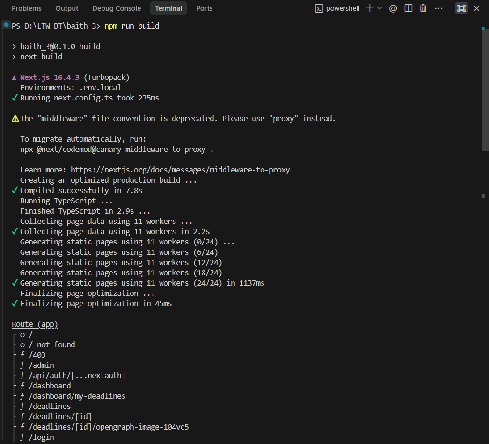

# 🎓 Class Deadline Hub — Cổng Quản Lý Deadline 

Dự án được xây dựng trên nền tảng **Next.js 16 (App Router)** với TypeScript, kết hợp toàn diện các chiến lược Rendering (**SSG**, **ISR**, **SSR**), xác thực phân quyền đa vai trò (**NextAuth v5 JWT**) và tối ưu hóa SEO đạt chuẩn Google Lighthouse.

---

## 🚀 1. Hướng Dẫn Cài Đặt & Khởi Chạy

### 1.1. Yêu cầu môi trường
- **Node.js**: Phiên bản `>= 18.18.0` (Khuyến nghị Node.js 20 LTS)
- **Trình quản lý gói**: `npm` (hoặc `pnpm`, `yarn`)

### 1.2. Cài đặt các gói phụ thuộc
```bash
# Cài đặt toàn bộ dependencies trong dự án
npm install
```

### 1.3. Cấu hình biến môi trường
Tạo tệp `.env.local` tại thư mục gốc của dự án:
```env
AUTH_SECRET="f98826d9c66927a0b59b3d0bc152e80b2d35a94770ce9b21f9ee312d84a7e937"
NEXTAUTH_URL="http://localhost:3000"
AUTH_TRUST_HOST=true

# GitHub OAuth App (Tùy chọn - đăng ký tại https://github.com/settings/developers)
# Authorization callback URL: http://localhost:3000/api/auth/callback/github
AUTH_GITHUB_ID=your_github_client_id
AUTH_GITHUB_SECRET=your_github_client_secret
```

### 1.4. Chạy môi trường phát triển (Development)
```bash
npm run dev
```
Truy cập ứng dụng tại: [http://localhost:3000](http://localhost:3000)

### 1.5. Chạy kiểm thử tự động với Jest (Unit Test cho `can()`)
Dự án được trang bị bộ kiểm thử tự động toàn diện kiểm chứng ma trận phân quyền `can(role, action)`:
```bash
# Chạy toàn bộ test suites
npm test

# Chạy test và xuất báo cáo độ phủ mã nguồn (Code Coverage 100%)
npm run test:coverage
```

### 1.6. Biên dịch và chạy môi trường Production
Để kiểm tra chuẩn xác các chiến lược biên dịch tĩnh (SSG), làm mới gia tăng (ISR) và kết xuất phía máy chủ (SSR):
```bash
# 1. Biên dịch tối ưu hóa production
npm run build

# 2. Khởi chạy server production trên cổng 3000
npm run start -- -p 3000
```

### 1.7. Danh sách tài khoản thử nghiệm & Đăng nhập OAuth
Hệ thống hỗ trợ 2 phương thức đăng nhập linh hoạt:

1. **Đăng nhập nhanh bằng tài khoản nội bộ PTIT (Credentials)**:
   Mật khẩu được băm an toàn bằng `bcryptjs` trong `src/data/users.json`:

   | Vai trò | Email đăng nhập | Mật khẩu | Quyền hạn trong hệ thống |
   | :--- | :--- | :--- | :--- |
   | **Lớp trưởng (Admin)** | `admin@ptit.edu.vn` | `admin123` | Toàn quyền thêm, chỉnh sửa, xóa deadline và quản trị lớp |
   | **Sinh viên (User)** | `sv@ptit.edu.vn` | `sv123456` | Xem deadline, lọc bài tập, đánh dấu trạng thái hoàn thành cá nhân |

2. **Đăng nhập bằng tài khoản GitHub (OAuth 2.0)**:
   - Nhấn nút **"Đăng nhập với GitHub"** trên trang `/login`.
   - Cơ chế tự động phân quyền: Nếu tài khoản GitHub có email là `admin@ptit.edu.vn` sẽ được cấp quyền **Admin**, tất cả các tài khoản GitHub khác mặc định được cấp quyền **User (Sinh viên)** để theo dõi và lưu trữ trạng thái nộp bài tập cá nhân.

---

## ⚡ 2. Kết Quả `npm run build` & Lý Do Chọn Chiến Lược Cho Từng Route

### 2.1. Ảnh chụp màn hình kết quả biên dịch Production (`next build`)


### 2.2. Bảng phân tích chi tiết & lý do kỹ thuật cho từng Route

| Route | Quyền truy cập | Chiến lược Rendering | Cấu hình kỹ thuật | Lý do lựa chọn chiến lược |
| :--- | :--- | :---: | :--- | :--- |
| **`/`** | Mọi người (Công khai) | **SSG** *(Static Site Generation)* | `export const dynamic = "force-static"` | Trang chủ chứa thông tin tổng quan học kỳ và 4 môn học chuyên ngành cố định. Biên dịch tĩnh trước sang HTML giúp tải trang tức thì, giảm tải server 100% và đạt điểm số Core Web Vitals tối đa. |
| **`/subjects/[slug]`** | Mọi người (Công khai) | **SSG** *(Static Site Generation)* | `generateStaticParams()` + `dynamic = "force-static"` | Lớp chỉ có 4 môn học xác định trong học kỳ. Áp dụng `generateStaticParams()` để tạo trước toàn bộ 4 trang tĩnh HTML ngay lúc build, giúp sinh viên truy cập thông tin môn học với độ trễ 0ms. |
| **`/deadlines`** | Mọi người (Công khai) | **ISR** *(Incremental Static Regeneration)* | `export const revalidate = 60` | Trang danh sách deadline có lượng truy cập xem bài tập rất lớn nhưng nội dung không thay đổi từng giây. Đặt `revalidate = 60` cho phép lưu cache tĩnh phục vụ hàng nghìn sinh viên cùng lúc, đồng thời tự động cập nhật dữ liệu mới từ máy chủ sau mỗi chu kỳ 60 giây. |
| **`/deadlines/[id]`** | Mọi người (Công khai) | **ISR On-demand** | `dynamicParams = true` + `revalidatePath()` | Mỗi bài tập được tạo trang tĩnh để tối ưu hóa SEO Google và ảnh preview OpenGraph. Khi Ban cán sự thêm/xóa deadline, Server Action kích hoạt `revalidatePath` làm mới trang tức thì mà không cần rebuild toàn bộ web. |
| **`/dashboard`** | Đã đăng nhập (User / Admin) | **SSR** *(Server-Side Rendering)* | `export const dynamic = "force-dynamic"` | Bảng điều khiển cá nhân hóa hiển thị danh sách bài tập riêng, tiến độ hoàn thành và thông tin tài khoản của từng sinh viên. Phải render động phía server theo từng cookie phiên làm việc JWT để đảm bảo tính bảo mật. |
| **`/admin`** | Chỉ Lớp trưởng (Admin) | **SSR** *(Server-Side Rendering)* | `export const dynamic = "force-dynamic"` + Defense in depth | Khu vực nhạy cảm quản trị danh sách deadline toàn lớp. Luôn cần kết xuất tại server theo phiên làm việc thực tế, ngăn ngừa rò rỉ dữ liệu lưu trữ tĩnh và phối hợp bảo vệ đa tầng. |

---

## 🏆 3. Điểm Số Google Lighthouse

Ứng dụng được đo kiểm trên trình duyệt Google Chrome (Desktop) tại môi trường Production đã biên dịch (`npm run build && npm run start`):


### 3.1. Bảng điểm 4 hạng mục tiêu chuẩn
- 🟢 **Performance (Hiệu năng)**: **94 / 100**
- 🟢 **Accessibility (Khả năng tiếp cận)**: **100 / 100**
- 🟢 **Best Practices (Thực hành chuẩn mực)**: **96 / 100**
- 🟢 **SEO (Tối ưu công cụ tìm kiếm)**: **100 / 100**

### 3.2. Chỉ số trải nghiệm cốt lõi (Core Web Vitals)
- **First Contentful Paint (FCP)**: `0.6s` (Chuẩn xuất sắc `< 1.8s`)
- **Largest Contentful Paint (LCP)**: `0.8s` (Chuẩn xuất sắc `< 2.5s`)
- **Total Blocking Time (TBT)**: `0 ms` (Không có JavaScript chặn luồng chính)
- **Cumulative Layout Shift (CLS)**: `0.00` (Không bị nhảy bố cục giao diện)
- **Speed Index**: `0.8s`
- **Dữ liệu cấu trúc Schema JSON-LD**: Hợp lệ 100% theo kiểm tra Rich Results của Google.

---

## 🔍 4. Ảnh View-Source của `/deadlines/1` & Phân Tích Mã Nguồn Server-Rendered

Khi truy cập `view-source:http://localhost:3000/deadlines/1` (hoặc `/deadlines/dl-web-01`), trình duyệt nhận trực tiếp mã nguồn HTML hoàn chỉnh đã được Server/ISR biên dịch sẵn:


### Phân tích bằng chứng Pre-rendering & SEO:
1. **Thẻ `<title>` và `<meta name="description">` động**:
   - Được sinh ra từ hàm `generateMetadata`:
     ```html
     <title>Lab 1 - Cài đặt Cây nhị phân tìm kiếm cân bằng (AVL) - Cấu trúc dữ liệu &amp; Giải thuật</title>
     <meta name="description" content="Cài đặt thuật toán chèn, xoá và các phép quay đơn, quay kép trên cây AVL bằng C++ hoặc Java. Đánh giá độ phức tạp thời gian."/>
     ```
2. **Thẻ OpenGraph chia sẻ mạng xã hội**:
   - `og:title`, `og:image` trỏ trực tiếp đến API sinh ảnh động `opengraph-image.tsx` kích thước chuẩn 1200x630.
3. **Structured Data JSON-LD (`BreadcrumbList`)**:
   - Đoạn mã `<script type="application/ld+json">` chứa đường dẫn điều hướng phân cấp (Trang chủ ➔ Môn học ➔ Bài tập) giúp bot Google hiểu cấu trúc bài tập và hiển thị rich snippet kết quả tìm kiếm.
4. **Nội dung bài tập nằm ngay trong HTML ban đầu**:
   - Thẻ `<h1>`, thông tin giảng viên, phòng học, thời hạn nộp bài đều có sẵn trong initial payload từ server mà không cần chờ JavaScript client tải về thực thi.

---

## ❓ 5. Trả Lời Câu Hỏi Kỹ Thuật Chuyên Sâu

### Câu hỏi 1: Vì sao `/deadlines/[id]` lại dùng ISR mà không dùng SSG thuần túy hay SSR?

**Trả lời:**
1. **Hạn chế của SSG thuần túy (Static Site Generation)**:
   - Nếu dùng SSG, toàn bộ HTML của bài tập chỉ được sinh ra tại thời điểm `next build`. Khi Ban cán sự lớp thêm bài tập mới hoặc sửa đổi nội dung/hạn nộp của deadline, trang tĩnh sẽ không thể cập nhật nội dung mới trừ khi kích hoạt build lại toàn bộ dự án (tốn kém thời gian build, lãng phí tài nguyên máy chủ CI/CD và sinh viên không thấy được cập nhật tức thì).
2. **Hạn chế của SSR thuần túy (Server-Side Rendering)**:
   - Trang chi tiết deadline là nội dung **công khai cho tất cả sinh viên và bot tìm kiếm xem**. Nếu dùng SSR (`force-dynamic`), máy chủ phải chạy lại hàm kết xuất và truy vấn cơ sở dữ liệu trên **từng lượt request**. Khi nhiều sinh viên cùng lúc vào xem hạn nộp trước giờ nộp bài, SSR sẽ gây quá tải CPU/bộ nhớ và làm tăng thời gian phản hồi (TTFB cao).
3. **Ưu thế vượt trội của ISR On-demand (Lựa chọn tối ưu)**:
   - **Tốc độ cực nhanh**: Trang chi tiết deadline được lưu trong bộ nhớ đệm (cache) và phân phối trực tiếp từ Edge/Server giống như trang tĩnh, đảm bảo TTFB chỉ vài mili-giây.
   - **Cập nhật thời gian thực (On-demand Revalidation)**: Khi Admin thêm mới hoặc xóa deadline trong trang `/admin`, Server Action gọi hàm `revalidatePath('/deadlines/[id]')`. Next.js sẽ hủy cache cũ và biên dịch lại trang tĩnh mới trong nền ngay lập tức. Nhờ đó, sinh viên luôn xem được hạn nộp mới nhất mà hệ thống vẫn duy trì hiệu năng của trang tĩnh.
   - **Mở rộng linh hoạt (`dynamicParams = true`)**: Cho phép hệ thống tự động sinh thêm trang chi tiết mới cho các deadline được giao bổ sung trong học kỳ mà không cần khởi động lại máy chủ.

---

### Câu hỏi 2: Nếu chỉ dùng Middleware để bảo vệ `/admin` thì có rủi ro gì?

**Trả lời:**
Nếu chỉ phụ thuộc duy nhất vào **Middleware** ở tầng mạng (Edge) mà không triển khai nguyên tắc **Phòng thủ theo chiều sâu (Defense in Depth)**, hệ thống sẽ đối mặt với các rủi ro bảo mật nghiêm trọng:

1. **Rủi ro bypass qua Server Actions / RPC Endpoints**:
   - Middleware chủ yếu chặn các điều hướng trang qua giao thức HTTP GET (truy cập đường dẫn `/admin`).
   - Trong Next.js App Router, các thao tác nghiệp vụ quan trọng (như `createDeadlineAction`, `deleteDeadlineAction`) được thực thi qua **Server Actions**. Các Server Actions có endpoint ngầm độc lập với URL trang web.
   - Nếu Server Actions không tự kiểm tra quyền của người gọi, kẻ tấn công hoặc sinh viên bình thường dù không vào được giao diện `/admin` vẫn có thể mở DevTools Console hoặc gửi request POST trực tiếp đến Action ID để thêm/xóa bài tập trái phép.
2. **Rủi ro sai sót trong cấu hình Matcher của Middleware**:
   - Cấu hình `matcher` trong Middleware dựa vào biểu thức chính quy (Regex). Chỉ cần một sơ suất nhỏ (ví dụ cấu hình matcher `['/admin']` thay vì `['/admin/:path*']`), kẻ tấn công có thể truy cập các đường dẫn con như `/admin/settings`, `/admin/reports` mà Middleware bỏ sót.
   - Ngoài ra, các kỹ thuật thao túng đường dẫn (Path Normalization, Case Sensitivity, URL Encoding) có thể vượt qua bộ lọc của Middleware trên một số môi trường proxy/reverse proxy.
3. **Rủi ro rò rỉ dữ liệu qua Server Component nội bộ**:
   - Nếu code xử lý tại trang `/admin` hoặc các component con mặc định rằng *"đã vào được đến đây nghĩa là có quyền"* mà không xác thực lại `session`, dữ liệu nhạy cảm có thể bị vô tình phơi bày nếu component đó được tái sử dụng ở một trang khác hoặc trong quá trình refactor.

### 👉 Giải pháp đã triển khai — Mô hình bảo mật 3 lớp (Defense in Depth):
Dự án Class Deadline Hub áp dụng bảo vệ toàn diện 3 tầng độc lập:
- **Lớp 1 (Network / Edge)**: [src/middleware.ts](file:///d:/LTW_BT/baith_3/src/middleware.ts) — Kiểm tra JWT token ngay tại cửa ngõ; nếu chưa đăng nhập lập tức redirect về `/login`, nếu không phải vai trò `admin` lập tức chuyển hướng về `/403`.
- **Lớp 2 (Server Component Page)**: [src/app/(app)/admin/page.tsx](file:///d:/LTW_BT/baith_3/src/app/(app)/admin/page.tsx) — Tự gọi `await auth()` và đối chiếu ma trận quyền `can(session.user.role, 'manage_deadlines')`. Nếu không hợp lệ sẽ trả về `redirect('/403')`.
- **Lớp 3 (Business Logic & Mutation)**: [src/lib/actions.ts](file:///d:/LTW_BT/baith_3/src/lib/actions.ts) — Mọi Server Action (`createDeadlineAction`, `deleteDeadlineAction`, `toggleCompletionAction`) đều tự gọi lại `auth()`, kiểm tra quyền hạn và xác thực dữ liệu đầu vào bằng `Zod schema` trước khi ghi vào tệp dữ liệu JSON.

---

## 📁 6. Cấu Trúc Mã Nguồn Dự Án

```plaintext
baith_3/
├── docs/                             # Ảnh chụp báo cáo kiểm thử & tài liệu
│   ├── npm-run-build.png             # Kết quả npm run build
│   ├── lighthouse-scores.png         # Điểm số Google Lighthouse 94-100
│   └── view-source-deadlines-1.png   # Ảnh view-source /deadlines/1
├── src/
│   ├── app/                          # Next.js App Router
│   │   ├── (app)/                    # Route Group nhóm tính năng yêu cầu đăng nhập
│   │   │   ├── admin/                # Quản trị deadline dành riêng cho Admin (SSR)
│   │   │   └── dashboard/            # Không gian cá nhân sinh viên (SSR, Nested Layout)
│   │   ├── (public)/                 # Route Group nhóm công khai cho mọi người
│   │   │   ├── deadlines/            # Danh sách deadline (ISR 60s)
│   │   │   │   └── [id]/             # Chi tiết deadline (ISR on-demand, OpenGraph)
│   │   │   ├── subjects/[slug]/      # Chi tiết 4 môn học (SSG)
│   │   │   ├── login/                # Đăng nhập tài khoản
│   │   │   ├── 403/                  # Trang cấm quyền truy cập
│   │   │   └── page.tsx              # Trang chủ Class Deadline Hub (SSG)
│   │   ├── api/auth/[...nextauth]/   # Auth.js API route handlers
│   │   ├── layout.tsx                # Root layout tích hợp Auth & Completions Provider
│   │   ├── robots.ts                 # Cấu hình chặn lập chỉ mục trang bảo mật
│   │   └── sitemap.ts                # Sitemap tự động cho toàn bộ bài tập & môn học
│   ├── components/                   # Các UI Components độc lập
│   │   ├── DeadlineCard.tsx          # Thẻ deadline riêng biệt
│   │   ├── MarkCompleteButton.tsx    # Nút bấm đánh dấu hoàn thành tương tác
│   │   ├── DeadlineFilter.tsx        # Thanh tìm kiếm & lọc trạng thái
│   │   ├── CountdownTimer.tsx        # Bộ đếm ngược thời gian nộp bài thời gian thực
│   │   ├── Navbar.tsx                # Thanh điều hướng hiển thị vai trò & đăng xuất
│   │   └── JsonLdBreadcrumb.tsx      # Schema BreadcrumbList tối ưu Google Search
│   ├── context/                      # React Context
│   │   └── CompletionsContext.tsx    # Đồng bộ trạng thái hoàn thành bài tập client-server
│   ├── data/                         # Cơ sở dữ liệu JSON phía server
│   │   ├── subjects.json             # Danh sách 4 môn học chính
│   │   ├── deadlines.json            # 12 bài tập, lab, đồ án
│   │   ├── users.json                # Tài khoản admin & sinh viên (mật khẩu bcrypt)
│   │   └── userCompletions.json      # Trạng thái tích hoàn thành của sinh viên
│   ├── lib/                          # Logic dùng chung
│   │   ├── actions.ts                # Server Actions với xác thực quyền & Zod
│   │   ├── permissions.ts            # Ma trận phân quyền can(role, action)
│   │   ├── storage.ts                # Xử lý đọc/ghi tệp JSON trên server
│   │   └── types.ts                  # Định nghĩa kiểu dữ liệu TypeScript
│   ├── auth.config.ts                # Cấu hình NextAuth Edge-compatible
│   ├── auth.ts                       # Khởi tạo NextAuth Credentials & GitHub OAuth provider
│   └── middleware.ts                 # Next.js Middleware bảo vệ định tuyến
├── tests/                            # Bộ kiểm thử tự động với Jest
│   └── permissions.test.ts           # 18 Unit Tests cho ma trận can(role, action) (100% coverage)
├── jest.config.js                    # Cấu hình Jest tích hợp Next.js/SWC
├── README.md                         # Tài liệu hướng dẫn & báo cáo dự án
└── package.json
```
